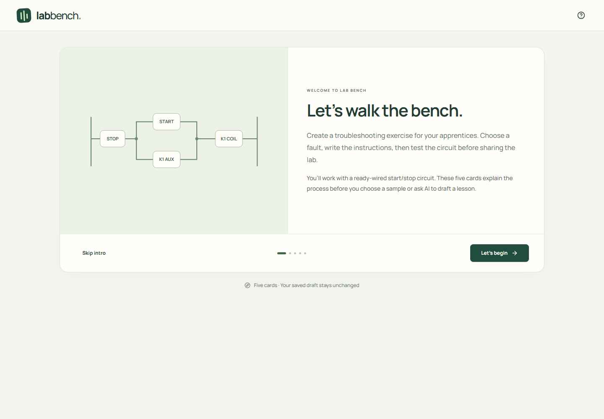

# Lab Bench

An instructor should be able to turn a troubleshooting idea into a usable lab without configuring a simulator from scratch. Lab Bench begins with five illustrated cards explaining the workflow. Choose a sample or describe a teaching goal, review the brief and fault, then try the exact exercise as an apprentice.

**Author a lab → check the symptom → export a reusable exercise.**

An independent product work sample by Matthew Gaiser, inspired by Dakota Prep's public instructor workflow. Not affiliated with Dakota Prep.



View the [scenario proposal](docs/scenario.png), [walkthrough](docs/walkthrough.png), [workbench](docs/workbench.png), or [apprentice preview](docs/apprentice-preview.png).

## Run it

Requires **Node.js 22.19 or newer** and npm. The walkthrough, sample, editor, preview, and export work without an account or API key.

```sh
npm ci
npm run build
npm start
```

Open **http://127.0.0.1:4173**. The release ZIP includes a production build: extract it and run `node scripts/serve.mjs` without installing packages. To use another port: `node scripts/serve.mjs --port 4200`.

For development, run `npm run dev`. It serves the same local AI API alongside Vite. Browser storage is scoped to the origin, so the development and production ports have separate drafts. `npm run preview` is a static Vite preview; use `npm start` for the complete app.

### Optional AI drafting

Set **OPENAI_API_KEY** in the environment of the process running `npm start` or `npm run dev`, then restart it. The existing process environment is used; `.env` files are not automatically loaded. Never put the key in a `VITE_` variable or source file. AI drafting uses paid OpenAI API requests; ordinary editing does not.

The server uses the Responses API with structured output and `store: false`, defaulting to `gpt-4o-mini-2024-07-18`. `OPENAI_MODEL` can select another model compatible with this structured-output schema. Requests have a 30-second deadline and a 1,800-token output cap, with one active request at a time and no automatic retries. Only the teaching request, the two most recent conversation exchanges, and the last valid proposal are sent. No browser draft is sent implicitly. API usage remains subject to the account's data policies and limits.

Try: **“Create a 15-minute beginner lab about a pump that runs only while START is held. Teach the holding contact and include two hints.”** Review the brief, answer, model-derived symptom, and hints. Ask for a revision, then choose **Use this lab**. Applying the proposal is one undoable edit. Unsupported scenarios return guidance instead of an invented circuit. Drafting remains a writing aid: instructors must check the wording and preview the behavior.

The server binds to loopback and checks Host/Origin before handling AI requests. It is intended for one local user; public hosting would require authentication and usage controls.

## Try the complete workflow

1. The first card is **Let’s walk the bench**. Choose **Let’s begin** to read five illustrated explanations, or **Skip intro** to choose a starting point. Select **Explore a ready-made lab**, then **Open sample editor**. **Show me around** in the editor replays the guide. The cards leave saved drafts unchanged; AI proposals survive navigation through the guide or editor during the current page session.
2. The sample has an open **W3 holding branch**. Select a conductor on the canvas or in the inspector; place or remove the fault. Drag a component to arrange the circuit, or focus it and use arrow keys. Undo restores the whole drag.
3. **Lab details** contains the objective, instructions, duration, and optional hints. Its **Next: choose a fault** button opens **Fault setup**, then **Next: review lab** opens the readiness checks. The authoring panel comes before the canvas on small screens.
4. Open **Apprentice preview**. Read the scenario, then use the controls above the circuit: turn on the supply and hold **START**. K1 energizes. Release START and it drops out because the holding branch is open. On small screens, scroll the diagram horizontally; **Reset zoom and pan** resets the canvas view.
5. Select **W3**, isolate the supply, and inspect the conductor. Write an explanation and check the diagnosis. The selected conductor is checked automatically; the written explanation is left for an instructor to discuss.
6. Return to authoring and **Export lab**. Load the sample or change the exercise, then **Import** the exported file to restore the exact brief, hints, fault, and layout. Undo can restore the previous draft.

The bundled [example lab](examples/holding-circuit.lab.json) can also be imported.

## What the sample covers

- An interactive SVG canvas with conductor selection, bounded component layout, keyboard movement, pan, zoom, and undo/redo.
- A paginated illustrated guide, a single starting choice, and separate AI composition and proposal-review screens with undo.
- Instructor authoring, an explicit readiness check, and a preview of a stable lab snapshot.
- A deterministic control-circuit model with five possible open-conductor locations.
- A versioned lab file with strict input validation and atomic import into the editor.
- Local draft persistence, visible storage failures, recovery of unreadable data, and conflict handling between tabs.
- Responsive authoring and apprentice views, keyboard controls, and automated accessibility checks.

## Model and product boundaries

This is a **fixed-topology, ideal-contact control model**. The STOP contact is normally closed; START and the K1 auxiliary contact are normally open. K1 can remain energized through its auxiliary contact after START is released. Layout changes do not change connectivity. There are no numeric meter readings, motor power circuit, overload protection, arbitrary wiring, installation guidance, or safety assessment.

Inspection exposes whether an isolated conductor is intact in the model. It does not simulate a multimeter or teach a physical isolation procedure. The preview hides the fault marker but is an instructor tool, not a secure assessment: exported files include the answer.

The application stores one draft locally. There is no roster, LMS, cloud account, or server database. That cut keeps the demonstration focused on authoring and preview rather than inventing Dakota's infrastructure. Cleared browser storage is not recoverable unless a lab file was exported.

## Verify

```sh
npm ci
npx playwright install chromium
npm run check
```

`npm run check` builds the production app, runs the model/file/storage and API-boundary tests, and tests the production build in Chromium. Default checks make no paid requests; browser tests disable the key on their own server and intercept AI responses. Tests cover proposal refinement and cancellation, walkthrough navigation and draft preservation, authoring through export/import, storage recovery, another-tab conflicts, keyboard and pointer movement, responsive layout, and axe accessibility checks. Browser tests own port 4187 and use isolated contexts. Accessibility automation is not a full manual accessibility audit.

`npm test` runs the domain and local API tests. After a build, `npm run test:e2e` runs the browser suite. **Optional paid check:** `npm run test:live` sends one bounded request using the configured key and checks the returned fault, duration, hints, and canonical lab contract. For formatting: `npm run format:check`.

To create a release, commit the source and run `npm run package` (requires Git). This builds from a clean worktree and produces `artifacts/lab-bench-1.2.0.zip` with the committed source, production assets, and a `release.json` identifying the source revision.

## How it is built

React and TypeScript handle the editor and preview. A small pure domain module owns file parsing, readiness checks, history, and the fixed circuit model. The SVG renderer derives conductor routes from constrained component positions. Vite produces static assets, including locally bundled fonts. The dependency-free Node server serves those assets and the optional AI API on loopback. Node's built-in TypeScript stripping lets the server share the browser's exact lab validator.

- `src/domain.ts`: canonical lab contract, validation, circuit transitions, editor history.
- `src/storage.ts`: draft loading and compare-before-write persistence.
- `src/CircuitCanvas.tsx`: SVG rendering and pointer/keyboard interactions.
- `src/Inspector.tsx`: the lab brief, fault settings, and readiness checks.
- `src/Preview.tsx`: apprentice controls, inspection, observations, and diagnosis.
- `src/App.tsx`: authoring workflow and file/storage integration.
- `src/StartPage.tsx` and `src/Walkthrough.tsx`: guided entry, scenario proposals, and the interface tour.
- `src/scenario.ts`: structured-output contract, canonical proposal parsing, and model-derived symptoms.
- `scripts/assistant.mjs`: bounded OpenAI requests and the local HTTP boundary.
- `tests/workflow.spec.ts`: tests against the built application in a real browser.

See [product decisions](docs/product-decisions.md) for the scope, tradeoffs, evidence, and next questions.

## References

- [Dakota Prep: digital labs for electrical programs](https://www.dakotaprep.com/schools) describes selecting circuits, introducing faults, and authoring instructor instructions. This informed the workflow, not any assumptions about its internal architecture.
- [Eaton Wiring Manual, chapter 3, page 3-32](https://www.eaton.com/content/dam/eaton/markets/machinebuilding/eaton-wiring-manual-pu08703001z-en-en-us.pdf) describes conventional start/stop control with a sealing auxiliary contact. Lab Bench intentionally models only that control behavior.
- [OpenAI structured outputs](https://developers.openai.com/api/docs/guides/structured-outputs?api-mode=responses) documents the response schema mechanism. Server-side lab validation still runs on every proposal.

Third-party code and font licenses are collected in `THIRD_PARTY_NOTICES.txt` in the release.
