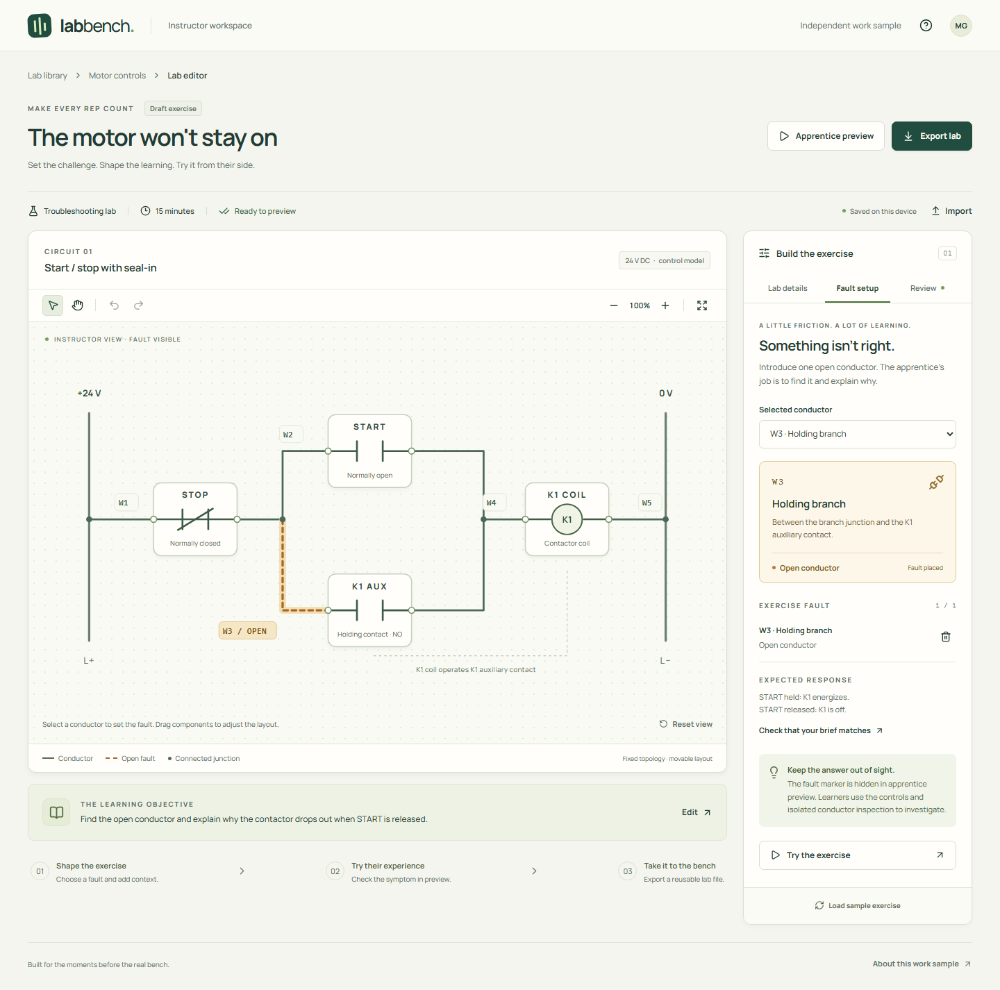

# Lab Bench

An instructor should be able to turn a troubleshooting idea into a usable lab without configuring a simulator from scratch. Lab Bench starts with a working start/stop control circuit, lets the instructor place one fault and write the brief, then runs the exact exercise in an apprentice preview.

**Author a lab → check the symptom → export a reusable exercise.**

An independent product work sample by Matthew Gaiser, inspired by Dakota Prep's public instructor workflow. Not affiliated with Dakota Prep.



## Run it

Requires **Node.js 22.19 or newer** and npm. No API key, account, or paid service is needed.

```sh
npm ci
npm run build
npm start
```

Open **http://127.0.0.1:4173**. The release ZIP includes a production build: extract it and run `node scripts/serve.mjs` without installing packages. To use another port: `node scripts/serve.mjs --port 4200`.

For development, run `npm run dev`. Browser storage is scoped to the origin, so the development and production ports have separate drafts.

## Try the complete workflow

1. The sample opens with an open **W3 holding branch**. Select a conductor on the canvas or in the inspector; place or remove the fault. Drag a component to arrange the circuit, or focus it and use arrow keys. Undo restores the whole drag.
2. Open **Lab details** to edit the objective, instructions, duration, and optional hints. **Review** identifies missing requirements.
3. Open **Apprentice preview**, turn on the supply, and hold **START**. K1 energizes. Release START and it drops out because the holding branch is open.
4. Select **W3**, isolate the supply, and inspect the conductor. Write an explanation and check the diagnosis. The selected conductor is checked automatically; the written explanation is left for an instructor to discuss.
5. Return to authoring and **Export lab**. Load the sample or change the exercise, then **Import** the exported file to restore the exact brief, hints, fault, and layout. Undo can restore the previous draft.

The bundled [example lab](examples/holding-circuit.lab.json) can also be imported.

## What the sample covers

- An interactive SVG canvas with conductor selection, bounded component layout, keyboard movement, pan, zoom, and undo/redo.
- Instructor authoring, an explicit readiness check, and a preview of a stable lab snapshot.
- A deterministic control-circuit model with five possible open-conductor locations.
- A versioned lab file with strict input validation and atomic import into the editor.
- Local draft persistence, visible storage failures, recovery of unreadable data, and conflict handling between tabs.
- Responsive authoring and apprentice views, keyboard controls, and automated accessibility checks.

## Model and product boundaries

This is a **fixed-topology, ideal-contact control model**. The STOP contact is normally closed; START and the K1 auxiliary contact are normally open. K1 can remain energized through its auxiliary contact after START is released. Layout changes do not change connectivity. There are no numeric meter readings, motor power circuit, overload protection, arbitrary wiring, installation guidance, or safety assessment.

Inspection exposes whether an isolated conductor is intact in the model. It does not simulate a multimeter or teach a physical isolation procedure. The preview hides the fault marker but is an instructor tool, not a secure assessment: exported files include the answer.

The application stores one draft locally. There is no roster, LMS, cloud account, or server database. That cut keeps the demonstration focused on authoring and preview rather than inventing Dakota's infrastructure. Cleared browser storage is not recoverable unless a lab file was exported.

## Verify

```sh
npm ci
npx playwright install chromium
npm run check
```

`npm run check` builds the production app, runs the model/file/storage tests, and tests the production build in Chromium. Browser tests start and stop their own server on port 4187 and use isolated browser contexts. They cover authoring through export/import, draft reload and recovery, another-tab conflicts, asynchronous import races, keyboard and pointer movement, preview behavior, responsive layout, and axe accessibility checks. Accessibility automation is not a full manual accessibility audit.

`npm test` runs the fast domain tests. After a build, `npm run test:e2e` runs the browser suite. For formatting: `npm run format:check`.

To create a release, commit the source and run `npm run package` (requires Git). This builds from a clean worktree and produces `artifacts/lab-bench-1.0.0.zip` with the committed source, production assets, and a `release.json` identifying the source revision.

## How it is built

React and TypeScript handle the editor and preview. A small pure domain module owns file parsing, readiness checks, history, and the fixed circuit model. The SVG renderer derives conductor routes from constrained component positions. Vite produces static assets, including locally bundled fonts. The supplied Node server only serves those assets on loopback.

- `src/domain.ts`: canonical lab contract, validation, circuit transitions, editor history.
- `src/storage.ts`: draft loading and compare-before-write persistence.
- `src/CircuitCanvas.tsx`: SVG rendering and pointer/keyboard interactions.
- `src/Inspector.tsx`: the lab brief, fault settings, and readiness checks.
- `src/Preview.tsx`: apprentice controls, inspection, observations, and diagnosis.
- `src/App.tsx`: authoring workflow and file/storage integration.
- `tests/workflow.spec.ts`: tests against the built application in a real browser.

See [product decisions](docs/product-decisions.md) for the scope, tradeoffs, evidence, and next questions.

## References

- [Dakota Prep: digital labs for electrical programs](https://www.dakotaprep.com/schools) describes selecting circuits, introducing faults, and authoring instructor instructions. This informed the workflow, not any assumptions about its internal architecture.
- [Eaton Wiring Manual, chapter 3, page 3-32](https://www.eaton.com/content/dam/eaton/markets/machinebuilding/eaton-wiring-manual-pu08703001z-en-en-us.pdf) describes conventional start/stop control with a sealing auxiliary contact. Lab Bench intentionally models only that control behavior.

Third-party code and font licenses are collected in `THIRD_PARTY_NOTICES.txt` in the release.
